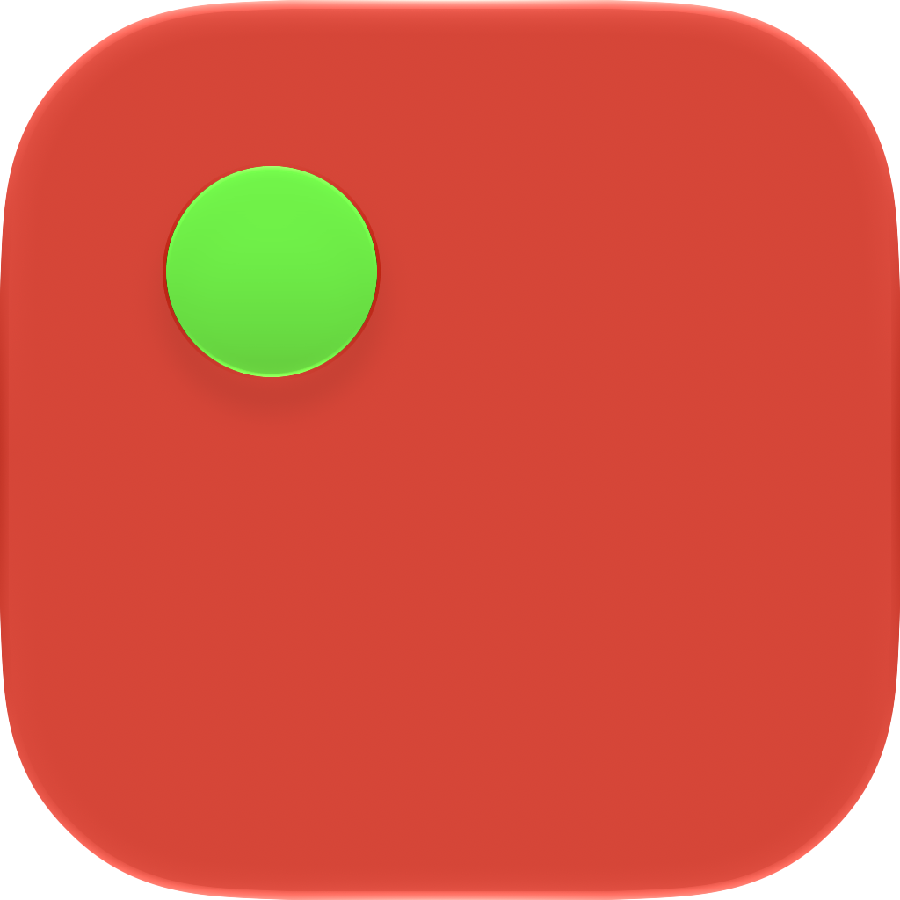

<!-- markdownlint-disable MD033 MD041 -->
<div align="center">

  

  <h1>🌶️ Capsaicin 🌶️</h1>

  <p><i>Macに、眠れない刺激を。</i></p>
  <p>
    <a href="https://github.com/koutyuke/Capsaicin/actions/workflows/ci.yml"></a>
    
    
    
    
  </p>

  <p>
    <a href="./README.md">🇬🇧 English</a> | <b>🇯🇵 日本語</b>
  </p>

  <p><sub>✦ ✦ ✦</sub></p>
</div>
<!-- markdownlint-enable MD033 -->

## 概要

**Capsaicin** は Mac のスリープを用途に合わせて止められるユーティリティアプリです。

- **スリープの防止**: 自動スリープ、ディスプレイスリープ、手動スリープなど、このアプリ 1 つで止めることができます。
- **ディスプレイを閉じてもスリープさせない**: MacBook のディスプレイを閉じた際の挙動も制御できます。デフォルトのシステムスリープはもちろん、ディスプレイスリープや画面をつけたままの状態のほか、閉じたときに画面の明るさを 0 にすることもできます。
- **自動解除**: タイマー、指定時刻、バッテリー残量の低下で自動的に解除でき、解除したら元のスリープ設定に戻すことができます。
- **複数の操作方法**: メニューバーのほか、ホットキーや CLI からでも開始・解除することができます。
- **HUD での通知**: 開始・解除の切り替えやアプリからの警告を、画面上に通知することができます。
- **Caps Lock LED での状態確認**: スリープを止めている間はキーボードの Caps Lock LED が点灯し、止めているかどうかを画面を見ずに確認することができます。Caps Lock の入力状態は変わらず、入力監視の権限も不要です。
- **最小限の root 権限**: root 権限が必要な処理は小さなヘルパーに集約し、特定の処理以外では root 権限を必要としません。

## 着想を得たアプリ

Capsaicin は、次の2つのアプリから着想を得て作りました。それぞれのアプリを作成・公開している開発者の方々に、心より感謝とリスペクトを申し上げます。

- [Capsomnia](https://github.com/fuji-mak/Capsomnia): Caps Lock をスリープを止めるスイッチにし、その LED で状態を示す macOS アプリです。Caps Lock の LED で状態を知らせる発想と、root 権限が要る処理だけを小さなヘルパーに任せる構成は、Capsomnia にならっています。
- [Amphetamine](https://apps.apple.com/app/amphetamine/id937984704): Mac のスリープを止めるアプリです。自動スリープを止めたうえで、ほかの種類のスリープを追加で止める形と、メニューから設定を選べる作りを参考にしました。

Capsaicin はこれらのアプリとは別のアプリとして独立して作っており、各開発者およびプロジェクトとは一切関係がありません。Capsaicin に関する不具合の報告やお問い合わせを、それぞれの開発者の方々へ行うことはお控えください。

## インストール

### サポート

- Apple Silicon の Mac（Intel の Mac には対応していません）
- macOS 26 以降

### GitHub Release

1. [Releases](https://github.com/koutyuke/Capsaicin/releases) から `Capsaicin-{バージョン}.zip` をダウンロードする。
2. zip を展開し、`Capsaicin.app` を「アプリケーション」フォルダーに移動する。
3. `Capsaicin.app` を開く。

ダウンロードした zip が改ざんされていないかは、同じリリースの `SHA256SUMS.txt` と照合するか、[GitHub CLI](https://cli.github.com/) で確かめられます。

```bash
shasum -a 256 -c SHA256SUMS.txt
gh attestation verify Capsaicin-{バージョン}.zip --repo koutyuke/Capsaicin
```

### Homebrew

自前の Homebrew tap で配布する予定です（準備中）。

## トラブルシューティング

### ほかのスリープ防止アプリを使っている場合

スリープを防止するほかのアプリが動いていると、スリープの設定が Capsaicin とぶつかり、意図どおりにスリープを止めたり元の設定に戻したりできないことがあります。Capsaicin を起動する前に、そのアプリを完全に終了してください。

### キー配列を変更するアプリを使っている場合

Karabiner-Elements などのキー配列を変更するアプリが Caps Lock の LED を制御していると、スリープを止めている間でも LED が消えることがあります。そのアプリの設定で、Caps Lock の LED の制御をオフにしてください。

#### Karabiner-Elements

設定画面で `Devices > 対象のキーボード > Manipulate caps lock LED`をオフにしてください。

## アンインストール

1. ヘルパーをインストールした場合は、Capsaicinの設定を開き、**ヘルパー**から**削除…**をクリックしてください。Capsaicinが止めていたスリープを元に戻してから、macOSへのヘルパーの登録を解除します。
2. メニューバーからCapsaicinを終了します。
3. `Capsaicin.app`をゴミ箱に移動します。CLI用のシンボリックリンクやエイリアスを作成した場合は、それも削除してください。
4. 設定や記録も削除するには、以下を実行します。

   ```bash
   defaults delete io.github.koutyuke.capsaicin
   rm -r ~/Library/Application\ Support/io.github.koutyuke.capsaicin
   ```

ヘルパーを削除する前にアプリを削除してしまった場合は、Capsaicinを再インストールし、手順1からやり直してください。

## ソースからビルドする

Xcode 27.2 と、flakes を有効にした Nix が必要です。

```bash
git clone https://github.com/koutyuke/Capsaicin.git
cd Capsaicin
nix develop --command just build
```

アプリは `.build/xcode/Build/Products/Debug/Capsaicin.app` に生成されます。

## 開発とテスト

```bash
nix develop --command just check  # 整形の検査、lint、すべてのテスト
nix develop --command just test   # 検査スクリプト、パッケージ、アプリのテスト
nix develop --command just fmt    # treefmt ですべてのファイルを整形
```

詳しくはドキュメントを参照してください。

## ドキュメント

- 🧭 [文書の入口](./docs/README.md) — 要件、仕様、判断の探し方
- 🎯 [アプリの概要](./docs/product/overview.md) — 目的、利用者、目標、非目標
- 📐 [仕様](./docs/specs/) — 機能ごとの振る舞い
- 🧱 [判断](./docs/meta/decisions/) — 何を選び、なぜ選び、いつ見直すか

## 貢献

不具合の報告と要望は、[Issues](https://github.com/koutyuke/Capsaicin/issues) で受け付けています。英語でも日本語でも構いません。

## ライセンス

Copyright 2026 koutyuke

本リポジトリは [MIT License](./LICENSE) のもとで公開されています。
