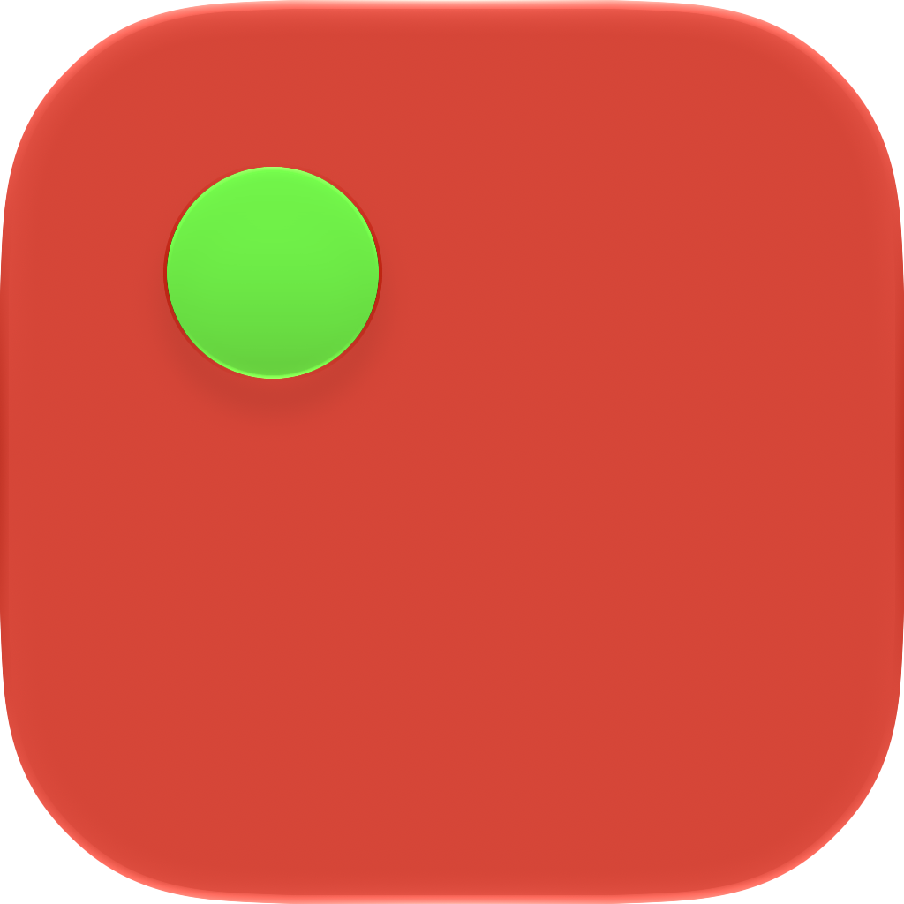

<!-- markdownlint-disable MD033 MD041 -->
<div align="center">

  

  <h1>🌶️ Capsaicin 🌶️</h1>

  <p><i>A spicy kick to keep your Mac awake.</i></p>
  <p>
    <a href="https://github.com/koutyuke/Capsaicin/actions/workflows/ci.yml"></a>
    
    
    
    
  </p>

  <p>
    <b>🇬🇧 English</b> | <a href="./README.ja.md">🇯🇵 日本語</a>
  </p>

  <p><sub>✦ ✦ ✦</sub></p>
</div>
<!-- markdownlint-enable MD033 -->

## Overview

**Capsaicin** is a macOS utility app designed to prevent your Mac from sleeping according to your needs.

- **Sleep Prevention**: Prevent idle sleep, display sleep, manual sleep, and more—all within a single app.
- **Keep Awake with Display Closed**: Control behavior when closing your MacBook's display. In addition to default system sleep, you can choose display sleep, keep the screen on, or set screen brightness to 0 when closed.
- **Automatic Deactivation**: Automatically restore normal sleep settings via timers, a scheduled time of day, or when the battery level drops low.
- **Multiple Ways to Control**: Start and end sleep prevention from the menu bar, configurable hotkeys, or the command line (CLI).
- **HUD Notifications**: Receive on-screen notifications for status toggles and app warnings.
- **Status via Caps Lock LED**: The Caps Lock LED lights up while sleep prevention is active, allowing you to check the status without looking at the screen. The actual Caps Lock typing state is not modified, and Input Monitoring permissions are not required.
- **Minimal Root Privileges**: Privileged operations requiring root are isolated into a small helper tool; root access is never requested for anything else.

## Inspiration

Capsaicin was inspired by the following two applications. We express our sincere gratitude and respect to their creators.

- [Capsomnia](https://github.com/fuji-mak/Capsomnia): A macOS app that turns Caps Lock into a sleep prevention switch and indicates state via its LED. Capsaicin adopts Capsomnia's idea of indicating state through the Caps Lock LED and delegating only root-required tasks to a minimal helper tool.
- [Amphetamine](https://apps.apple.com/app/amphetamine/id937984704): A Mac keep-awake app. Capsaicin references its approach of preventing idle sleep first while allowing users to optionally suppress other sleep types, as well as its menu-based configuration structure.

Capsaicin is developed independently as a separate application and is not affiliated with either developer or project. Please do not contact the creators of those applications regarding bugs or inquiries about Capsaicin.

## Installation

### Supported Environments

- Apple Silicon Mac (Intel Macs are not supported)
- macOS 26 or later

### GitHub Releases

1. Download `Capsaicin-{version}.dmg` from [Releases](https://github.com/koutyuke/Capsaicin/releases).
2. Open the DMG and drag `Capsaicin.app` onto the `Applications` link.
3. Open the copy of `Capsaicin.app` in your Applications folder.

To verify that the downloaded DMG has not been tampered with, compare it against `SHA256SUMS.txt` from the release or verify it using the [GitHub CLI](https://cli.github.com/). Run these commands in the folder that contains both the DMG and `SHA256SUMS.txt`:

```bash
shasum -a 256 -c SHA256SUMS.txt
gh attestation verify "Capsaicin-{version}.dmg" --repo koutyuke/Capsaicin
```

### Homebrew

```bash
brew install --cask koutyuke/tap/capsaicin
```

This also links the `capsaicin` command into Homebrew's `bin`.

Capsaicin installs its own updates from within the app, so you don't need `brew upgrade` for it. To update it with `brew upgrade`, pass `--greedy`.

## Troubleshooting

### Other Sleep Prevention Apps

If another app that prevents sleep is running, its sleep settings can conflict with Capsaicin's, and Capsaicin may not prevent sleep or restore your settings as expected. Quit the other app completely before launching Capsaicin.

### Key Remapping Apps

If a key remapping app such as Karabiner-Elements controls the Caps Lock LED, the LED may turn off even while sleep prevention is active. Turn off Caps Lock LED control in that app's settings.

#### Karabiner-Elements

In the settings window, turn off `Devices > (your keyboard) > Manipulate caps lock LED`.

## Uninstallation

1. If you installed the helper, open Capsaicin's settings, go to **Helper**, and click **Remove…**. This turns sleep back on if Capsaicin turned it off, then unregisters the helper from macOS.
2. If you installed Capsaicin with Homebrew, run `brew uninstall --cask capsaicin`. This quits Capsaicin and removes the app and the `capsaicin` command, so you can skip the remaining steps. To also remove your settings and records, add `--zap`.
3. Quit Capsaicin from the menu bar.
4. Move `Capsaicin.app` to the Trash. If you created a symbolic link or alias for the CLI, remove it as well.
5. To also remove your settings and records, run:

   ```bash
   defaults delete io.github.koutyuke.capsaicin
   rm -r ~/Library/Application\ Support/io.github.koutyuke.capsaicin
   ```

If you deleted the app before deleting the helper, reinstall Capsaicin and start again from step 1.

## Development & Testing

Requires an Apple Silicon Mac with macOS 26 or later, Xcode 27.2, and Nix with flakes enabled.

```bash
git clone https://github.com/koutyuke/Capsaicin.git
cd Capsaicin
```

The main commands are:

```bash
nix develop --command just build  # Generate the Xcode project and build the Debug app
nix develop --command just check  # Format check, linting, and all tests
nix develop --command just test   # Script, package, and app tests
nix develop --command just lint   # Lint code and docs, and check build tool versions
nix develop --command just fmt    # Format all files with treefmt
```

`just build` generates the app at `.build/xcode/Build/Products/Debug/Capsaicin.app`. This build is ad-hoc signed, so the **Helper** settings show **Unavailable in this build**, and the settings that require the helper (**Also prevent sleep from Apple menu**, and options other than **Put Mac to sleep (default)** for **When display is closed**) cannot be used. Software updates are also unavailable in Debug builds.

For other recipes, see the [justfile](./justfile).

## Documentation

The documentation is written in Japanese.

- 🧭 [Documentation Index](./docs/README.md) — How to find requirements, specifications, and design decisions
- 🎯 [Product Overview](./docs/product/overview.md) — Purpose, target users, goals, and non-goals
- 📐 [Specifications](./docs/specs/) — Behavioral specifications for each feature
- 🧱 [Decisions](./docs/meta/decisions/) — Architectural decisions: choices, rationale, and revisit triggers

## Contributing

Bug reports and feature requests are welcome in [Issues](https://github.com/koutyuke/Capsaicin/issues), in English or Japanese.

## License

Copyright 2026 koutyuke

Licensed under the [MIT License](./LICENSE).
